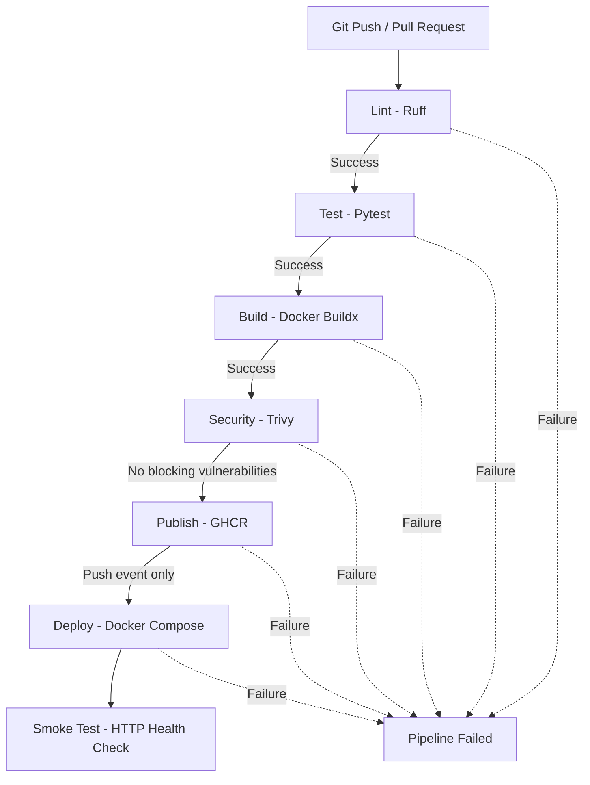

# Docker Flask Redis — CI/CD Pipeline

A containerized REST API built with Python, Flask, Redis, Docker and Docker Compose, integrated with a complete CI/CD pipeline using GitHub Actions.

The project demonstrates an automated software delivery lifecycle, from code quality checks and unit testing to Docker image building, security scanning, publication and deployment.

---

## Architecture

### Application Architecture

- **Flask:** REST API.
- **Gunicorn:** WSGI application server.
- **Redis:** In-memory data store.
- **Docker:** Application containerization.
- **Docker Compose:** Multi-container orchestration.

### CI/CD Architecture

The project uses GitHub Actions to automate the application lifecycle.



### Pipeline Jobs

| Job | Tool | Description |
|---|---|---|
| Lint | Ruff | Checks Python code quality and formatting. |
| Test | pytest | Executes unit tests for the Flask API. |
| Build | Docker Buildx | Builds and exports the Docker image. |
| Security | Trivy | Scans the Docker image for OS and library vulnerabilities. |
| Publish | GHCR | Publishes the validated Docker image to GitHub Container Registry. |
| Deploy | Docker Compose | Deploys the published image in a test environment and executes smoke tests. |

Jobs are executed sequentially through GitHub Actions dependencies (`needs`).

The pipeline is triggered by pushes to `main`, `dev`, `staging` and `feature/**`, and by pull requests targeting `main`, `dev` or `staging`.

Publishing and deployment are restricted to push events.

### CI/CD Workflow Details

**1. Lint — Code Quality**

- Checks Python code using Ruff.
- Detects common code quality issues.
- Verifies code formatting.
- Prevents subsequent jobs from running when quality checks fail.

Commands:

```bash
ruff check .
ruff format --check .
```

**2. Test — Unit Testing**

- Executes unit tests using pytest.
- Tests Flask API endpoints.
- Uses Flask's test client.
- Mocks Redis interactions for isolated unit testing.
- Blocks the pipeline if a test fails.

Command:

```bash
python -m pytest -v
```

**3. Build — Docker Image Construction**

- Initializes Docker Buildx.
- Builds the application image using the Dockerfile.
- Tags the image with the Git commit SHA.
- Loads the image into the Docker engine.
- Exports the image as a TAR artifact for subsequent jobs.

**4. Security — Vulnerability Scanning**

Uses Trivy to analyze the Docker image.

The scan covers:

- Operating system packages.
- Application libraries and dependencies.
- Known security vulnerabilities.

Security policy:

| Severity | Pipeline behavior |
|---|---|
| CRITICAL | Blocking |
| HIGH | Blocking |
| MEDIUM | Non-blocking |
| LOW | Non-blocking |

Unfixed vulnerabilities are ignored during the scan.

The pipeline stops when fixable HIGH or CRITICAL vulnerabilities are detected.

The Docker image is transferred between jobs using GitHub Actions artifacts.

**5. Publish — Docker Image Publication**

Publishes the validated Docker image to GitHub Container Registry (GHCR).

- Authenticates using the automatically generated `GITHUB_TOKEN`.
- Grants the workflow `packages: write` permission.
- Publishes the image using its Git commit SHA.
- Publishes an additional `dev` tag for pushes to the development branch.

Image naming:

```text
ghcr.io/crazyfranck23/docker-flask-redis:dev
ghcr.io/crazyfranck23/docker-flask-redis:<commit-sha>
```

The image published is the same image that passed the Trivy security scan.

**6. Deploy — Test Environment Deployment**

Deploys the published image using Docker Compose.

Deployment process:

1. Authenticates with GHCR.
2. Pulls the image corresponding to the current Git commit.
3. Starts the Flask application and Redis.
4. Waits for services to become operational.
5. Checks container status.
6. Executes an HTTP smoke test against `/health`.
7. Displays application logs if deployment fails.
8. Cleans up containers and volumes after execution.

The deployment uses a dedicated `compose.deploy.yaml` configuration.

The test environment runs on a GitHub-hosted runner and is temporary. Containers are removed after the workflow completes.

---

## Prerequisites

- Git
- Python 3.12 or compatible version for the application image
- Docker Desktop with WSL 2 integration
- Docker Compose
- GitHub account

For CI/CD development:

- GitHub repository
- GitHub Actions enabled
- GitHub Container Registry (GHCR)
- GitHub Actions permissions allowing package publication

---

## Project Structure

```text
docker-flask-redis/
│
├── .github/
│   └── workflows/
│       └── ci.yml
│
├── app/
│   ├── __init__.py
│   └── routes.py
│
├── tests/
│   └── test_routes.py
│
├── .env.example
├── .gitignore
├── .dockerignore
│
├── requirements.txt
├── requirements-dev.txt
│
├── Dockerfile
├── compose.yaml
├── compose.deploy.yaml
│
└── README.md
```

---

## Installation

Clone the repository:

```bash
git clone https://github.com/crazyfranck23/docker-flask-redis.git

cd docker-flask-redis
```

Create the environment file:

```bash
cp .env.example .env
```

Start the application:

```bash
docker compose up -d --build
```

Check running containers:

```bash
docker compose ps
```

---

## API Endpoints

| Method | Endpoint | Description |
|---|---|---|
| GET | `/` | Welcome message |
| GET | `/health` | Application and Redis health check |
| GET | `/info` | Application information |

## Access

API:

```text
http://localhost:5000
```

Health check:

```text
http://localhost:5000/health
```

Application information:

```text
http://localhost:5000/info
```

---

## Environment Variables

| Variable | Default | Description |
|---|---|---|
| APP_VERSION | 1.0.0 | Application version |
| REDIS_HOST | redis | Redis hostname |
| REDIS_PORT | 6379 | Redis port |

The local Docker Compose configuration uses the `.env` file.

The deployment configuration injects the required environment variables directly into the application container.

---

## Testing

Install development dependencies:

```bash
python -m pip install -r requirements-dev.txt
```

Run unit tests:

```bash
python -m pytest -v
```

Run code quality checks:

```bash
ruff check .
ruff format --check .
```

The unit tests cover:

- API root endpoint.
- Redis connected health status.
- Redis disconnected health status.
- Application information endpoint.

Redis interactions are mocked during unit testing to isolate the application logic.

---

## Docker Image

Build the image locally:

```bash
docker build -t docker-flask-redis:local .
```

List Docker images:

```bash
docker images
```

Inspect the image:

```bash
docker image inspect docker-flask-redis:local
```

Run the container independently if required:

```bash
docker run -d \
  --name flask-api \
  -p 5000:5000 \
  docker-flask-redis:local
```

---

## GitHub Container Registry (GHCR)

The CI/CD pipeline automatically publishes validated Docker images to GHCR.

Repository:

```text
ghcr.io/crazyfranck23/docker-flask-redis
```

Available tags:

| Tag | Description |
|---|---|
| `dev` | Latest successfully published image from the dev branch. |
| `<commit-sha>` | Image associated with a specific Git commit. |

### Pull the published image

```bash
docker pull ghcr.io/crazyfranck23/docker-flask-redis:dev
```

Pull a specific version:

```bash
docker pull ghcr.io/crazyfranck23/docker-flask-redis:<commit-sha>
```

### Authenticate with GHCR

For private packages, authenticate locally using a GitHub Personal Access Token with package read permissions:

```bash
echo YOUR_GITHUB_TOKEN | docker login ghcr.io \
  -u YOUR_GITHUB_USERNAME \
  --password-stdin
```

The GitHub Actions workflow uses `GITHUB_TOKEN` automatically and does not require a manually configured PAT.

---

## Test Environment Deployment

The CI/CD pipeline automatically deploys the published image to a temporary test environment.

Deployment configuration:

```text
compose.deploy.yaml
```

### Deploy manually

Set the image variables:

```bash
export IMAGE_NAME=ghcr.io/crazyfranck23/docker-flask-redis
export IMAGE_TAG=dev
```

Start the application:

```bash
docker compose -f compose.deploy.yaml up -d --pull always --wait --wait-timeout 60
```

Check containers:

```bash
docker compose -f compose.deploy.yaml ps
```

Check application logs:

```bash
docker compose -f compose.deploy.yaml logs app
```

Check Redis logs:

```bash
docker compose -f compose.deploy.yaml logs redis
```

Execute the smoke test:

```bash
curl --fail http://localhost:5000/health
```

Expected response when the application and Redis are healthy:

```json
{
  "status": "healthy",
  "redis": "connected"
}
```

Stop the test environment:

```bash
docker compose -f compose.deploy.yaml down -v
```

---

## CI/CD Validation Results

The complete CI/CD pipeline was successfully implemented and tested.

| Validation | Expected Result | Status |
|---|---|---|
| Ruff code analysis | No linting errors | Passed |
| Ruff formatting | Correct formatting | Passed |
| Pytest | All unit tests successful | Passed |
| Docker Build | Image successfully constructed | Passed |
| Trivy Security Scan | No blocking fixable HIGH or CRITICAL vulnerabilities | Passed |
| GHCR Publication | Image successfully published | Passed |
| Docker Compose Deployment | Application and Redis started | Passed |
| HTTP Smoke Test | `/health` returns HTTP 200 and healthy status | Passed |
| Failure Handling | Failed unit test blocks subsequent jobs | Passed |

### Failure Handling Validation

A deliberate failure was introduced into a unit test to validate pipeline behavior.

Expected behavior:

- Lint succeeds.
- Test fails.
- Build is skipped.
- Security is skipped.
- Publish is skipped.
- Deploy is skipped.

The pipeline behaved as expected.

After restoring the test, all six jobs successfully completed.

---

## Useful Commands

### Docker Compose

Start:

```bash
docker compose up -d --build
```

Stop:

```bash
docker compose stop
```

View containers:

```bash
docker compose ps
```

View logs:

```bash
docker compose logs -f
```

Restart:

```bash
docker compose restart
```

Stop and remove containers:

```bash
docker compose down
```

Stop and remove containers and volumes:

```bash
docker compose down -v
```

### Git

Check working tree:

```bash
git status
```

Commit changes:

```bash
git add .
git commit -m "your commit message"
```

Push changes:

```bash
git push origin dev
```

---

## Technologies Used

| Category | Technologies |
|---|---|
| Programming Language | Python |
| Web Framework | Flask |
| WSGI Server | Gunicorn |
| Database / Cache | Redis |
| Containerization | Docker |
| Orchestration | Docker Compose |
| Version Control | Git |
| Source Code Hosting | GitHub |
| CI/CD | GitHub Actions |
| Code Quality | Ruff |
| Unit Testing | pytest |
| Container Security | Trivy |
| Image Registry | GitHub Container Registry |
| Build System | Docker Buildx |

---

## Key Learning Outcomes

Through this project, the following Cloud DevOps concepts were implemented:

- Designing and implementing a complete CI/CD pipeline.
- Automating code quality checks and unit testing.
- Working with GitHub Actions workflows, jobs, steps and runners.
- Managing job dependencies with `needs`.
- Building Docker images automatically.
- Transferring Docker images between CI jobs using GitHub Actions artifacts.
- Integrating container vulnerability scanning into CI/CD.
- Managing security-related pipeline failures.
- Publishing container images to GHCR.
- Managing image tags and Git commit-based versioning.
- Deploying containerized applications with Docker Compose.
- Implementing automated HTTP smoke tests.
- Handling pipeline failures and preventing invalid releases.

---

## Author

Franck NOUTSA FOTSO
